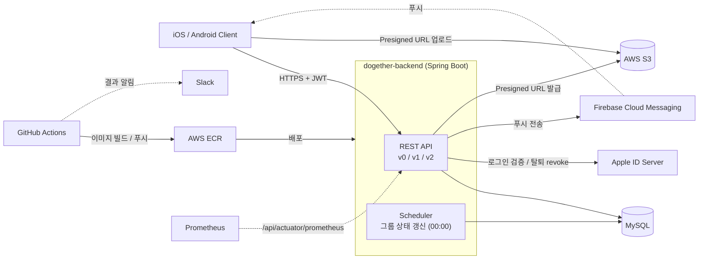

<div align="center">


각자의 속도와 목적을 지닌 사람들이 모여 **투두를 인증하고 피드백**을 주고받으며,<br>
작은 성취들이 모여 확실한 변화를 만드는 **데일리 투두 서비스**입니다.

</div>

---

## 목차

* [Stack](#stack)
* [프로젝트 구조](#프로젝트-구조)
* [주요 기능 소개](#주요-기능-소개)
* [시스템 아키텍처](#시스템-아키텍처)
* [실행 가이드](#실행-가이드)
* [팀원](#팀원)

---

## Stack

**Language**


**Framework**


**Build Tool**


**Database**


-09476B?style=for-the-badge&logo=databricks&logoColor=white)

**Auth**


**Infra**


**Test**


**Monitoring**


**Tools**


---

## 프로젝트 구조

해당 프로젝트는 **모놀리식 아키텍처**로 구성되어 있으며, 도메인 단위로 패키지를 나누고 각 패키지 안에서 `controller → service → repository → entity` 4계층을 유지합니다.

### 💡 설계 의도 및 도입 배경

**모놀리식 아키텍처**
- 초기 서비스의 빠른 시장 검증과 신속한 기능 구현을 우선순위로 두었습니다.
- 제한된 리소스 환경 속에서 팀 내 직접 운영 및 유지보수의 효율성을 높이고자 모놀리식 구조를 선택했습니다.

**도메인 별 패키지 구성**
- 챌린지 그룹, 투두, 인증, 알림 등 비즈니스 도메인 단위로 로직을 응집시켜 결합도를 낮추고 응집도를 높였습니다.
- 이를 통해 비즈니스 정책 변경이나 요구사항 수정 시 영향 범위를 최소화하고, 코드의 유지보수성과 가독성을 향상시켰습니다.

```
dogether-backend
├── src
│   ├── main
│   │   ├── java/site/dogether
│   │   │   ├── DogetherApplication.java
│   │   │   ├── auth                      # Apple/Kakao 로그인, JWT, @Authenticated 인자 해석
│   │   │   ├── member                    # 회원
│   │   │   ├── challengegroup            # 챌린지 그룹, 참여, 랭킹, 상태 갱신 스케줄러
│   │   │   ├── dailytodo                 # 투두 작성/조회
│   │   │   ├── dailytodocertification    # 투두 인증, 리뷰
│   │   │   ├── dailytodohistory          # 투두 히스토리, 읽음 처리
│   │   │   ├── memberactivity            # 내 활동, 인증 통계
│   │   │   ├── reminder                  # 인증/리뷰 리마인드
│   │   │   ├── notification              # FCM 푸시, 알림 토큰
│   │   │   ├── s3                        # Presigned URL 발급
│   │   │   ├── appinfo                   # 강제 업데이트 체크
│   │   │   ├── developer_test            # 테스트용 API (prod 제외)
│   │   │   └── common                    # 공통 응답, 예외 처리, 필터, 설정
│   │   └── resources
│   │       ├── application*.yml          # local, dev, prod, pt 프로파일
│   │       ├── logback                   # 프로파일별 로그 설정
│   │       └── static/docs               # REST Docs 결과물
│   ├── test                              # 도메인별 단위/서비스 테스트, REST Docs 테스트
│   └── docs/asciidoc                     # REST Docs 문서 원본
├── docker
│   ├── Dockerfile
│   └── local_mysql/docker-compose.yml    # 로컬 MySQL
├── k6                                    # 부하 테스트 스크립트
└── .github/workflows/ci-cd.yml           # CI/CD
```

---

## 주요 기능 소개

### 👤 회원
* **회원 관리:** Apple, Kakao 소셜 로그인, 회원 탈퇴

### 👥 챌린지 그룹
* **그룹 관리:** 챌린지 그룹 생성, 참여 코드로 참여, 그룹 나가기
* **랭킹:** 그룹원 간 달성률 순위 조회

### ✅ 투두와 인증
* **투두 관리:** 그룹별 투두 작성 및 조회
* **투두 인증:** 사진/영상으로 투두 수행 인증
* **투두 인증 검사:** 그룹원이 인증을 승인 또는 반려
* **투두 히스토리:** 그룹원의 오늘 투두 활동 확인

### 📊 내 활동
* **활동 조회:** 인증 통계, 활동 요약, 인증 목록 조회

### 🔔 알림
* **푸시 알림:** 그룹 참여, 인증 요청, 리뷰 결과 알림
* **리마인드:** 인증/리뷰를 미루는 그룹원에게 재촉 알림

---

## 시스템 아키텍처



### 패키지와 프로파일

단일 모듈이므로 실행 단위는 하나이며, 프로파일로 환경을 구분합니다.

| 프로파일 | 용도 | 포트 | DB 설정 | ddl-auto |
|---|---|---|---|---|
| `local` (기본) | 로컬 개발 | 8080 | `localhost:33306/dogether` | `update` |
| `dev` | 개발 서버 | `APPLICATION_PORT` | `DB_URL`, `DB_USERNAME`, `DB_PASSWORD` | `update` |
| `prod` | 운영 서버 | `APPLICATION_PORT` | `DB_URL`, `DB_USERNAME`, `DB_PASSWORD` | `validate` |
| `pt` | 성능 테스트 | `APPLICATION_PORT` | `DB_URL`, `DB_USERNAME`, `DB_PASSWORD` | `update` |

---

## 실행 가이드

### 사전 요구사항

- Java 17
- Docker (로컬 MySQL 실행용)
- Firebase 서비스 계정 키 파일
- AWS, Apple 관련 설정 값

### 1. 인프라 실행

```bash
cd docker/local_mysql
docker compose up -d
```

- 로컬 MySQL 기본값은 아래와 같습니다.

```
Host     : localhost
Port     : 33306
Database : dogether
Username : root
Password : root
```

### 2. 환경 변수 및 설정 파일 준비

**Firebase 키 파일**

아래 경로에 서비스 계정 키 파일을 둡니다. 이 경로는 `.gitignore`에 등록되어 있으며, 파일이 없으면 애플리케이션이 시작되지 않습니다.

```
src/main/resources/firebase/dogether-firebase-key.json
```

**환경 변수**

| 변수 | 설명 |
|---|---|
| `JWT_SECRET_KEY` | JWT 서명 키 (32자 이상) |
| `JWT_EXPIRE_TIME` | JWT 만료 시간 (ms) |
| `AWS_S3_BUCKET_NAME` | S3 버킷 이름 |
| `AWS_REGION` | AWS 리전 |
| `AWS_ACCESS_KEY` | AWS 액세스 키 |
| `AWS_SECRET_KEY` | AWS 시크릿 키 |
| `APPLE_KEY_ID` | Apple 키 ID |
| `APPLE_TEAM_ID` | Apple 팀 ID |
| `APPLE_CLIENT_ID` | Apple 클라이언트 ID |
| `APPLE_PRIVATE_KEY` | Apple 개인 키 |

```bash
export JWT_SECRET_KEY=<your-jwt-secret-key>
export JWT_EXPIRE_TIME=<expire-time-ms>
export AWS_S3_BUCKET_NAME=<your-bucket-name>
export AWS_REGION=<your-region>
export AWS_ACCESS_KEY=<your-access-key>
export AWS_SECRET_KEY=<your-secret-key>
export APPLE_KEY_ID=<your-apple-key-id>
export APPLE_TEAM_ID=<your-apple-team-id>
export APPLE_CLIENT_ID=<your-apple-client-id>
export APPLE_PRIVATE_KEY=<your-apple-private-key>
```

### 3. 서비스 실행

```bash
./gradlew bootRun
```

기본 프로파일은 `local`이며 `8080` 포트로 실행됩니다. 아래 명령으로 실행 여부를 확인할 수 있습니다.

```bash
curl localhost:8080/api/health-check
```

### 4. 테스트 및 API 문서

**단위 / 서비스 테스트**

```bash
./gradlew test
```

**API 문서 생성**

```bash
./gradlew restDocsTest asciidoctor
```

- `./gradlew build` 시 문서가 `src/main/resources/static/docs`로 복사되며, 실행 후 http://localhost:8080/docs/index.html 에서 확인할 수 있습니다.

---

## 팀원
|  이름 | 깃허브 아이디      |
|-----|--------------|
| 양성욱 | @kelly6bf    |
| 황서은 | @Hwangseoeun |
